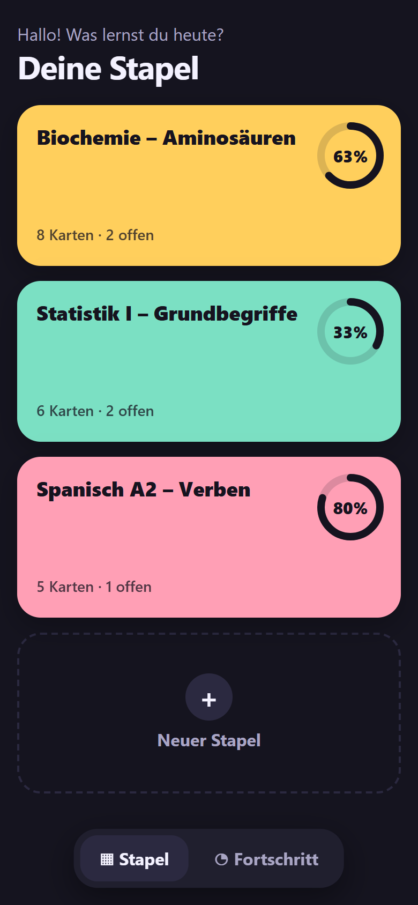
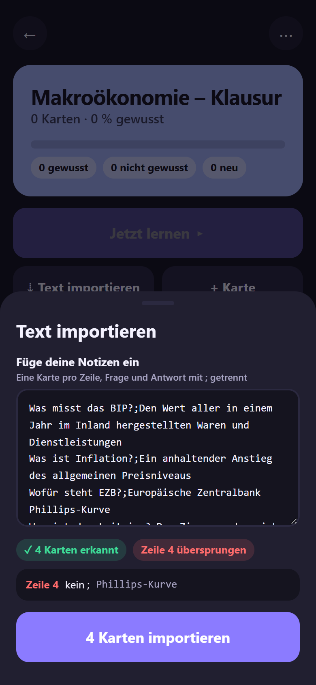
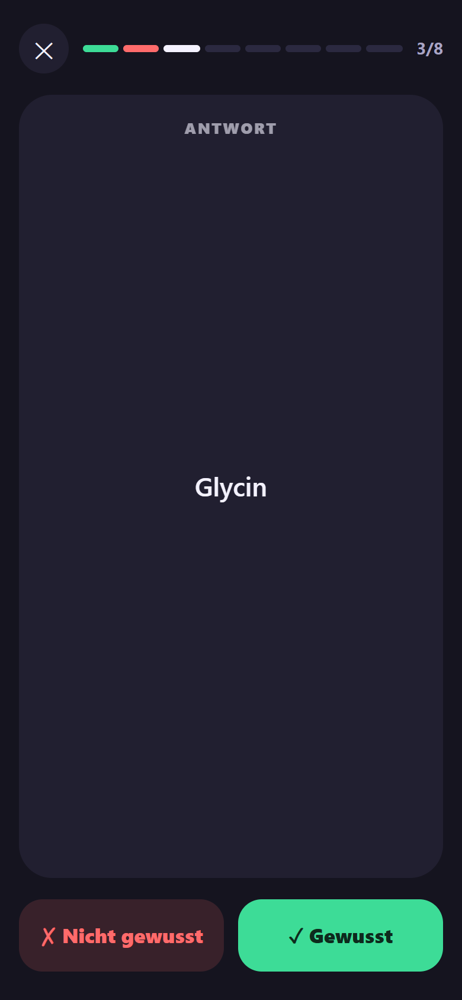

# Lernkarten

Karteikarten für die Klausurvorbereitung: Stapel anlegen, Fragen aus den eigenen Notizen einfügen und sofort abfragen. Kein Konto, kein Server, alles bleibt im Browser. Läuft auf Handy und Laptop.

**▶ Live ausprobieren:** https://adrijus-lazdauskas.github.io/hack-sandbox/

| Übersicht | Import | Abfrage |
| :---: | :---: | :---: |
|  |  |  |

## Demo in fünf Schritten

1. **Stapel anlegen:** Auf „Neuer Stapel“ tippen, „Makroökonomie – Klausur“ eingeben, eine Farbe wählen.
2. **Karten importieren:** In der Stapel-Ansicht „Text importieren“ öffnen und ein paar Zeilen `Frage;Antwort` einfügen. Die App zeigt sofort, wie viele Karten erkannt und welche Zeilen übersprungen wurden.
3. **Abfragen:** „Jetzt lernen“, Karte antippen zum Umdrehen, dann „Gewusst“ oder „Nicht gewusst“.
4. **Ergebnis sehen:** Nach der Runde steht da, wie viele Karten sitzen. Mit „nicht gewusste wiederholen“ geht es direkt in eine zweite Runde nur mit den offenen Karten.
5. **Fortschritt pro Stapel:** Zurück in der Übersicht zeigt jeder Stapel seinen Fortschrittsring, der Tab „Fortschritt“ die Summen. Alles bleibt auch nach dem Neuladen erhalten.

Zum Ausprobieren, einfach in den Import kopieren:

```text
Was misst das BIP?;Den Wert aller in einem Jahr im Inland hergestellten Waren und Dienstleistungen
Was ist Inflation?;Ein anhaltender Anstieg des allgemeinen Preisniveaus
Wofür steht EZB?;Europäische Zentralbank
Was ist der Leitzins?;Der Zins, zu dem sich Geschäftsbanken Geld bei der Zentralbank leihen
```

Am Laptop geht die Abfrage auch per Tastatur: Leertaste dreht um, `J` = gewusst, `N` = nicht gewusst, `Esc` beendet.

## Lokal starten

Voraussetzung: Node.js 22.12 oder neuer.

```bash
npm install
npm run dev
```

Dann die angezeigte Adresse öffnen (meist http://localhost:5173).

| Befehl | Was es macht |
| --- | --- |
| `npm run dev` | Entwicklungsserver mit Hot Reload |
| `npm test` | Unit-Tests (Vitest) |
| `npm run lint` | ESLint |
| `npm run build` | Produktions-Build nach `dist/` |
| `npm run preview` | Den Build lokal ansehen |

## Technik

Vite, React und TypeScript, normales CSS, Hash-Routing. Die Daten liegen im `localStorage` unter `lernkarten.v1`. Jeder Push auf `main` landet automatisch in der Vorschau auf GitHub Pages.

Mehr dazu: [`docs/ARCHITECTURE.md`](docs/ARCHITECTURE.md) (Aufbau und Schnittstellen), [`IDEA.md`](IDEA.md) (die Idee) und [`DECISIONS.md`](DECISIONS.md) (was das Team entschieden hat).
